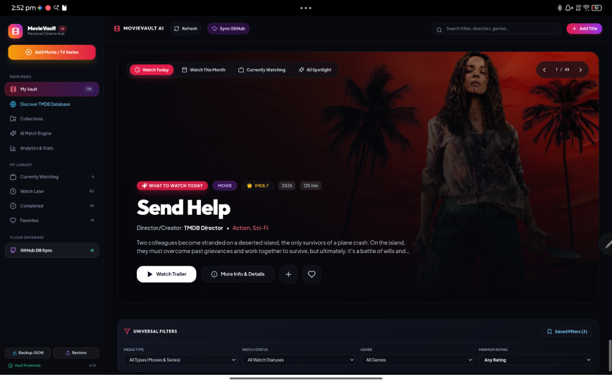
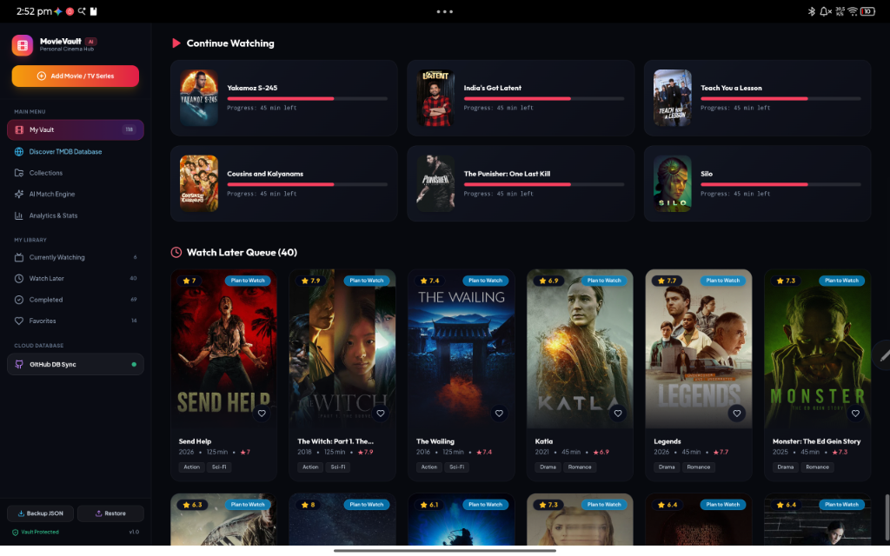
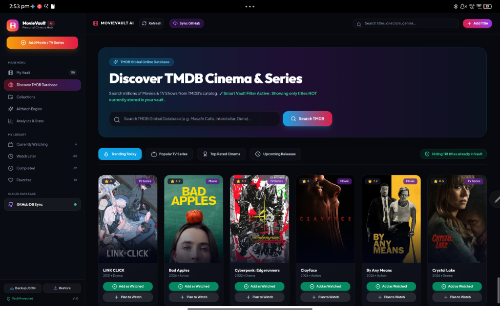

# 🎬 MovieVault AI — Personal Cinema Hub

<div align="center">



### *"Your Intelligent Personal Media Vault, Watch Queue, and Discovery Engine."*

[](https://react.dev/)
[](https://www.typescriptlang.org/)
[](https://tailwindcss.com/)
[](https://www.themoviedb.org/)
[](#-git-as-a-database-architecture)
[](LICENSE.md)

[Overview](#-overview) • [UI Showcase](#-visual-showcase) • [Core Pillars](#-key-features--pillars) • [Architecture](#-system-architecture) • [Database Schema](#-data-architecture) • [Tech Stack](#-technical-stack)

</div>

---

> [!NOTE]
> **Portfolio Showcase & Development Hub**: This repository contains development specifications, architectural documentation, user interface assets, and data schemas for **MovieVault AI**. The core client codebase is proprietary, and individual personal cinema databases are synchronized privately to [Anvithgopa/movievault-db](https://github.com/Anvithgopa/movievault-db).

---

## 📌 Overview

**MovieVault AI** is a modern personal entertainment dashboard designed for cinephiles and series enthusiasts. Built with a sleek dark-glassmorphism aesthetic, it combines:
1. **Curated Vault Management**: Tracking *Currently Watching*, *Watch Later*, *Completed*, and *Favorites* with real-time remaining-time progress bars.
2. **Global TMDB Discovery**: Direct integration with The Movie Database (TMDB), enriched with a proprietary **Smart Vault Filter** that automatically hides titles already in your collection.
3. **Git-as-a-Database (GitHub DB Sync)**: A serverless synchronization engine that persists user watchlist states directly to a private GitHub repository via GitHub REST APIs, providing version control, zero cloud hosting fees, and complete data ownership.

---

## 📱 Visual Showcase

<div align="center">

### 1. Cinematic Spotlight & Universal Filter Bar
*Interactive hero carousel with embedded trailers, comprehensive metadata, and multi-axis facet filtering.*


---

### 2. Personal Vault & Real-Time Queue
*Queue management featuring watch progress bars (`45 min left`), priority tagging, and one-click cloud backup.*


---

### 3. TMDB Global Discovery & Smart Vault Filtering
*Explore trending cinema and TV series with automatic exclusion of titles already stored in your vault.*


</div>

---

## ✨ Key Features & Pillars

### 1. 🔍 Smart Vault Filter™
When browsing global databases like TMDB, users often see titles they have already saved or watched. MovieVault AI introduces client-side Bloom filtering and set intersection to dynamically hide all cataloged movies from search and discovery grids (e.g. *"Hiding 118 titles already in Vault"*), keeping discovery feeds fresh.

### 2. ⚡ Git-as-a-Database Architecture
Rather than relying on costly third-party database-as-a-service providers (Supabase, Firebase, DynamoDB), MovieVault AI implements a secure, serverless Git synchronization engine:
- Persists user collections locally using `LocalStorage` with optimistic UI updates.
- Uses the GitHub REST API to perform atomic commits and synchronization with the user's private [`movievault-db`](https://github.com/Anvithgopa/movievault-db) repository.
- Full backup & restore with single-click JSON downloads and versioned rollback history.

### 3. 🎯 Universal Filtering & Saved Presets
- **Media Type**: Granular toggles between feature films, documentaries, and episodic television.
- **Watch Status**: Instant partitioning into *Currently Watching*, *Plan to Watch*, *Completed*, and *Favorites*.
- **Rating Matrix**: Multi-score evaluation balancing official IMDb/TMDB scores against the user's personal rating.
- **Saved Presets**: Quick-access bookmarks for custom multi-parameter filter configurations.

### 4. 🎬 Integrated Player & Streaming Availability
- In-app YouTube trailer streaming with backdrop visualizer.
- Country-specific streaming platform detection (Prime Video, Apple TV, Netflix, Disney+).

---

## 🏛️ System Architecture

```mermaid
flowchart TD
    subgraph UI ["MovieVault AI Client Layer"]
        Hero["Spotlight Hero & Trailer Player"]
        Vault["Personal Vault (Queue & Progress)"]
        Discover["TMDB Discover Grid"]
        Filters["Universal Filter Engine"]
        Cache["LocalStorage Client State"]
    end

    subgraph TMDB ["The Movie Database (TMDB) API"]
        Trending["Trending & Popular Feeds"]
        Search["Title & Director Search"]
        Details["Backdrops, Cast, & Streaming Availability"]
    end

    subgraph CloudSync ["GitHub Git-as-a-Database Layer"]
        SyncEngine["GitHub DB Sync Manager"]
        PrivateRepo["Private Backup Repo\n(Anvithgopa/movievault-db)"]
        VaultJSON["vault_database.json\n(Version Controlled)"]
    end

    Discover -->|Query Titles| Search
    Discover -->|Fetch Feeds| Trending
    Hero -->|Fetch Media Assets| Details

    Discover <-->|Check Already Stored GIDs| Cache
    Vault <-->|Read & Write Library| Cache

    Cache <-->|Bidirectional Sync| SyncEngine
    SyncEngine <-->|GitHub REST API (Commits / Trees)| PrivateRepo
    PrivateRepo --- VaultJSON
```

---

## 🗄️ Data Architecture

The application persists library state in a normalized, portable JSON format. A full JSON Schema specification is provided in [`docs/schema/vault_schema.json`](docs/schema/vault_schema.json):

```json
{
  "id": "tmdb-1198994",
  "title": "Send Help",
  "mediaType": "Movie",
  "poster": "https://image.tmdb.org/t/p/w500/...",
  "backdrop": "https://image.tmdb.org/t/p/w1280/...",
  "trailerUrl": "https://www.youtube.com/embed/...",
  "imdbRating": 7.0,
  "personalRating": 7.0,
  "genres": ["Action", "Sci-Fi"],
  "runtime": 125,
  "releaseYear": 2026,
  "watchStatus": "Plan to Watch",
  "watchLaterPriority": "High",
  "streamingPlatforms": ["Prime Video", "Apple TV"],
  "favorite": false
}
```

---

## 💻 Technical Stack

| Domain | Technology | Purpose |
| :--- | :--- | :--- |
| **Frontend Framework** | React 18 / Next.js | Reactive component tree, fast navigation, and server-side rendering |
| **Styling** | Tailwind CSS 3/4 | Responsive dark-mode glassmorphism theme and typography |
| **Icons & Visuals** | Lucide Icons | Clean, modern iconography |
| **External Catalog** | TMDB REST API v3 | Rich movie/series metadata, cast lists, high-res posters, and backdrops |
| **Persistence & Cloud Sync** | GitHub REST API | Git-as-a-Database version control to private repository |
| **Media Playback** | YouTube IFrame API | Seamless embedded cinematic trailer playback |

---

## 🔒 Security & Data Privacy

- **Data Sovereignty**: The user owns 100% of their cinema library data. Data is never monetized or fed into commercial marketing algorithms.
- **Token Security**: Personal GitHub access tokens for Cloud DB Sync are stored exclusively in the browser's local sandbox and are never transmitted to third-party intermediate proxies.
- **Private Database Separation**: Sensitive user databases remain safely segregated in private repositories (`movievault-db`), while architectural and showcase assets reside in this public repository.

---

## 📄 License

Copyright © 2026 Anvith Gopa. All rights reserved.  
The source code and intellectual property of MovieVault AI are proprietary. See [LICENSE.md](LICENSE.md) for full terms.

---

## 👤 Author & Maintainer

**Anvith Gopa**  
GitHub: [@Anvithgopa](https://github.com/Anvithgopa)
